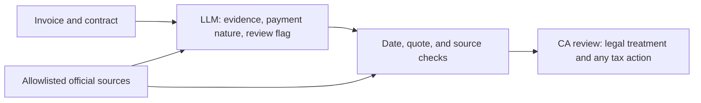

# Remittance Evidence and Routing Assistant

## What it does

This prototype prepares a first-pass evidence and routing record for an Indian tax reviewer handling cross-border payments. It extracts exact invoice and contract passages, proposes a payment nature, flags transaction-specific uncertainty, and links the draft to retrieved official source text.

It does **not** decide final tax treatment, treaty eligibility, chargeability, withholding, or tax rates. A qualified Chartered Accountant must review the evidence and determine any action.

## Why this workflow

The task requires reading payment documents, identifying what the payment is for, and checking whether important facts or supporting documents are missing or conflict. A keyword-only rule can assign a confident label without resolving those issues. An LLM can help extract and organize evidence; deterministic checks validate quoted passages, date regimes, source freshness, and review routing. The human remains accountable for legal conclusions.

## Architecture



The output keeps **payment nature** separate from **review required**. A payment can have a clear nature and still need review because a material fact, document, timing question, or treaty issue remains unresolved. Rates are disabled in the prototype.

The code is split by responsibility while retaining one run command: `pipeline_eval.py` handles the CLI and benchmark, `remittance_cases.py` holds case data and labels, `remittance_sources.py` holds the legal-source registry and retrieval checks, and `remittance_pipeline.py` contains the prompt, API client, and routing logic. Keep these files together in `E:\.vscode`.

## Data and evaluation

- The development set contains 14 synthetic invoice and contract examples. It contains no real client or personal financial data.
- Official legal pages and treaty PDFs are fetched from an allowlist, parsed into text, and cached with retrieval timestamps and SHA-256 hashes.
- The development benchmark has legacy combined labels plus separate author-assigned payment-nature and review labels. These labels have not been independently adjudicated, so its metrics are printed as exploratory development signals, not validated performance.
- Comparable scorecards use the same routing gold, payment-nature gold, and review-flag gold for the keyword baseline, abstain-all baseline, and model. A legacy combined-label score is printed in a separate historical section and must not be compared with those scorecards. For the single-label baselines, `needs review` maps to `uncertain` nature plus review required; a predicted category maps to review not required.
- Latest complete benchmark: run `20261103_040135`, 2026-11-03, development set, one run, 14 synthetic cases per prompt mode. Requested and served model: `deepseek/deepseek-v4.1-flash-1017`. Against author-assigned, not independently adjudicated labels, both modes scored 10/14 (71.4%) final-route accuracy, 12/14 (85.7%) payment-nature accuracy, and 10/14 (71.4%) review-flag accuracy. These are development signals, not legal validation; one run does not establish repeatability.
- The aggregate model scores tied with each other; they do not show a benefit from source context. Neither mode missed a review flag against the current labels, and each added unnecessary review flags on cases 1, 2, 10, and 12. Nature mismatches were cases 6 and 7 without context, and cases 3 and 7 with context. Exact invoice/contract quote checks passed 14/14 in both modes. Citation presence was 0/14 in the registry and 1/14 in source text without context, and 12/14 in both with-context presence checks; none of these establish legal citation accuracy or claim support.
- The run made 29 actual HTTP requests for 28 case/mode outputs: case 2 needed one retry. There were 0 API errors; the summary records 251,882 provider-reported tokens. Exact raw responses and per-case request counts are in `raw_llm_runs_20261103_040135.jsonl`; metrics and per-case errors are in `results_summary_20261103_040135.txt`. The earlier 2026-11-02 run remains archived as a development failure record: source-context mode had two API errors and exhausted its 28-request cap before all cases completed.
- Reproduce with `python pipeline_eval.py --model deepseek/deepseek-v4.1-flash-1017 --dataset development --modes both --runs 1 --max-api-calls 84 --sleep 2.5`. The 84-call value is a hard ceiling for retries, not the count used in this completed run.
- A separate interrupted rerun made two without-context requests for cases 1 and 2. Because those cases are already included in the complete run, the partial rerun is excluded from the repository and all scorecards.
- Development case 7 combines an individual payee, possible work in Mumbai and London, and an unrecorded India-day count. Its review reason should name both actual service locations and total India stay-days; it is not an independently validated tax conclusion.
- Eight new holdout cases are included as a separate dataset. Their treaty-document statuses are `unknown` unless the case facts explicitly establish presence or absence. Every evidence-inventory item shows its status, source, and source detail in the model prompt and result log. `supplied` and `missing` values are synthetic fixture assertions; the supporting files and independent absence checks are not attached. The cases cannot run until independent payment-nature and review labels and a blind-review record with reviewer name/role/qualification, date, rationale and sources are entered; no holdout answers are prefilled. Before any model API request, the script also requires each official treaty source to refresh successfully or have a usable cache no older than 30 days. Reviewer qualifications are self-attested in the record and are not verified by the script.

> **Citation-presence limitation:** The completed 2026-11-03 run reported “citation present in registry” for 0/14 without source context and 12/14 with source context; “citation present in source text” was 1/14 and 12/14, respectively. These checks ask whether a reference is listed and whether its root label appears somewhere in retrieved text. They do not confirm the citation maps to the right source or subsection, supports the model's specific statement, or applies to the transaction. Do not describe them as legal citation accuracy. Stronger verification requires mapping each citation to its source and provision, then having a reviewer assess whether that provision supports the claim. Verbatim quote checks only confirm that a quote appears in the supplied synthetic document.

## Run it

Requirements: Python 3.11 or later; dependencies are listed in `requirements.txt`.

In Windows PowerShell, from the cloned repository directory:

```powershell
$PY = "$env:LOCALAPPDATA\Programs\Python\Python311\python.exe" # set this to your regular Windows Python 3.11+ executable
& $PY -m pip install -r .\requirements.txt
$env:OPENROUTER_API_KEY = "your-key"
$MODEL_SLUG = "provider/model-id" # replace with one exact OpenRouter model slug
& $PY .\pipeline_eval.py --model $MODEL_SLUG --modes both --runs 1 --max-api-calls 84
```

Use the same `$PY` executable for installing dependencies and running the script. If `python` resolves to MSYS2 and says `No module named pip`, select your regular Windows CPython path explicitly as above.

Use `--modes without-context` to omit legal excerpts from the model prompt, `--modes with-context` to include them, or `--modes both` to compare both. **Both modes still retrieve official sources** for downstream source freshness, routing, and citation checks; the comparison isolates the effect of showing source excerpts to the model. Each case can use up to three API attempts. The hard request cap defaults to 84 for the 28 planned case/mode calls (14 cases × 2 modes × 3 attempts). A smaller explicit cap may limit retries or prevent some later cases from being attempted. Three consecutive case failures stop the run, and the partial JSONL and summary are preserved. `--dataset holdout` is blocked until all 8 cases have independent gold labels and blind-review records. Canada and Australia treaty sources are PDFs and require `pypdf`.

### Try one new synthetic case

The fixed benchmark is still available, and a judge can also submit one new case as JSON. Start by copying `judge_case_template.json`, then replace the synthetic invoice/contract text and transaction facts. Keep evidence statuses explicit as `supplied`, `missing`, or `unknown`, with a source and short detail for each. Unknown must not be changed to missing just because a document was not mentioned. The input is not independently verified; use synthetic data only, never real client documents or personal information.

```powershell
$MODEL_SLUG = "deepseek/deepseek-v4.1-flash-1017" # replace with an exact model slug if needed
python pipeline_eval.py --model $MODEL_SLUG --case-file .\judge_case_template.json
```

Single-case mode defaults to source context in the prompt and allows up to 3 actual API attempts for that case. This mode does not calculate benchmark accuracy because a user-entered case has no adjudicated gold label. It prints the evidence inventory, proposed payment nature, review flag and reasons, final route, served model, and source-presence checks. It does not save the case text or result unless `--output .\case_result.json` is supplied. Legal-source support must already be configured for the payee country; otherwise the run stops before calling the model. Use `--modes without-context` to omit source excerpts from the prompt, or set `--max-api-calls` to choose another request cap.

`--model` is required, and `auto` is rejected so runs use an explicitly selected model slug. For the holdout, the script checks treaty-source retrieval or a fresh cache before sending model requests; a missing or inaccessible source stops the run. The summary reports the actual served model IDs; if they vary, treat the run as non-comparable and investigate before making a performance claim. Each run prints sample size, payment-nature and review-flag metrics, and case-level mismatches against all three gold targets. Development results remain exploratory until qualified reviewers independently adjudicate the labels without seeing model outputs.

The final code records the requested model slug, exact raw model response, parsed output, served model, actual per-case request count, and provider-reported token usage when available. Prompt hashes and character counts identify prompts without recording the full prompt. The 2026-11-03 final JSONL records the exact raw response for every successful model output. Generated run logs are ignored by Git by default; include only the reviewed final run files in a submission package.

The script can also read `OPENROUTER_API_KEY` from a local `.env` file. Copy `.env.example` to `.env` and replace the placeholder locally. Do not commit `.env` or paste an API key into source code. Results are written to timestamped `raw_llm_runs_*.jsonl` and `results_summary_*.txt` files in the current directory.

## Limitations and risks

- The case set is small, synthetic, and author-labeled; the scores are development signals, not evidence of legal accuracy.
- One model run does not establish repeatability.
- Treaty and statutory interpretation can depend on facts outside the invoice and contract.
- A source can be official and still be outdated for a particular payment date or legal question; source retrieval does not itself establish legal applicability.
- Before any tax position is taken, a CA must verify the source, facts, treaty requirements, chargeability, withholding, and procedural forms.
